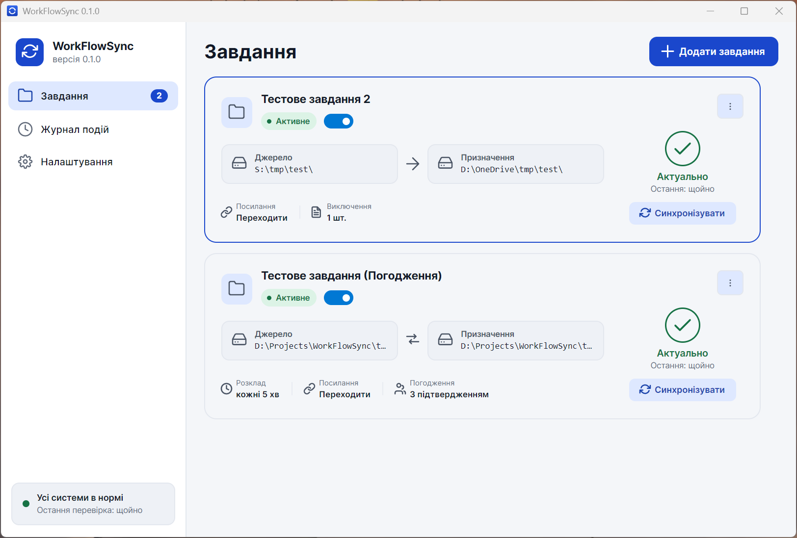
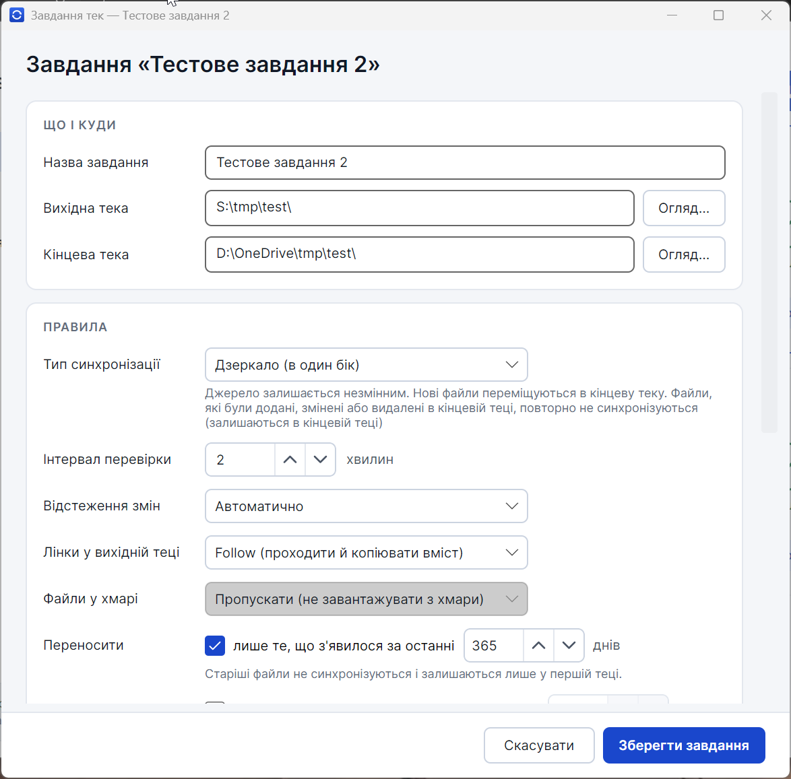
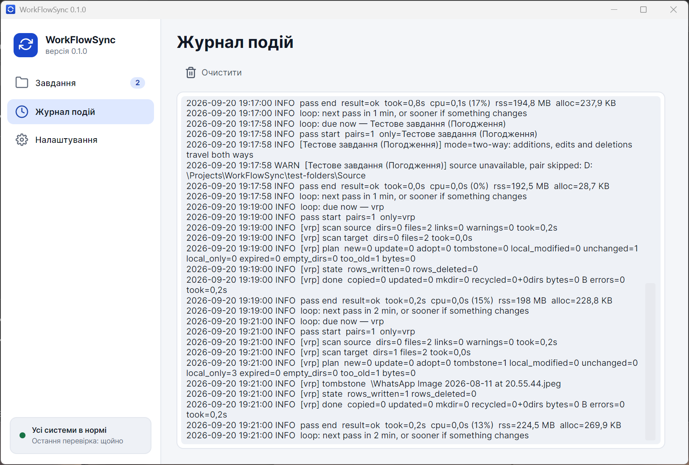
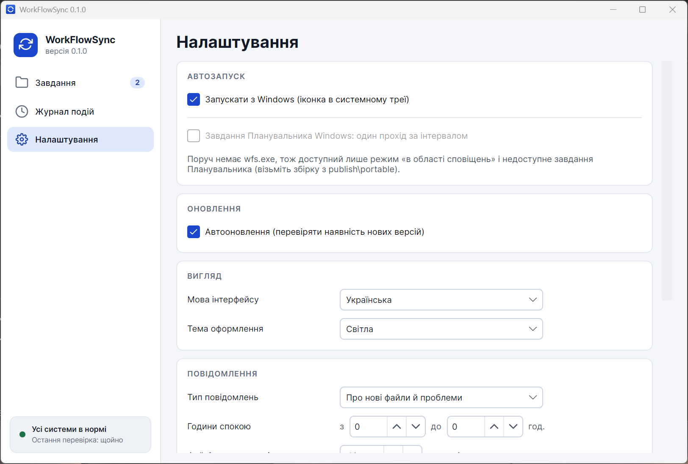
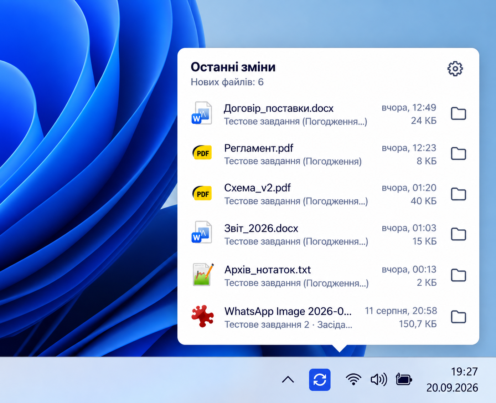

# WorkFlowSync: синхронізація файлів та папок

<p align="center">
  <a href="README.md"><b>🇬🇧 English</b></a> •
  <a href="README.uk.md"><b>🇺🇦 Українська</b></a>
</p>

<p align="center">
  
  
  
  
  
</p>

**WorkFlowSync** — проста, надійна та зручна програма для синхронізації файлів і папок на Windows, розроблена для захисту ваших робочих даних при роботі з локальними дисками, спільними мережевими папками (SMB), **Google Drive** та **OneDrive**.

Вона створена для того, щоб ваші робочі документи, проєкти чи архіви завжди були під рукою в актуальному стані. Наприклад, ви можете налаштувати синхронізацію між спільною папкою на сервері компанії, Google Диском та вашою локальною папкою (зокрема в OneDrive). Програма сама відстежує зміни і виконує всю рутину за вас.

Головна перевага: **програма пам'ятає історію ваших дій**. Більшість звичайних синхронізаторів діють наосліп і можуть ненароком перетерти ваші свіжі правки або знову завантажити файли, які ви давно видалили. WorkFlowSync знає, що ви змінили чи прибрали у себе, тому ваші файли завжди в безпеці, а чужі правки не знищать вашу роботу.

Працює на Windows відразу після розпаковки, без встановлення та без прав адміністратора.

---

## Як виглядає програма

### 1. Головне вікно зі списком ваших завдань
Тут зібрані всі ваші пари папок для синхронізації. Ви бачите стан кожного завдання, коли була остання перевірка, активні прапорці та обсяг синхронізованих файлів. Запустити або призупинити будь-яке завдання можна в один клік.



### 2. Просте та зручне налаштування завдання
Налаштувати завдання можна буквально за хвилину: вибираєте папки, задаєте розклад і правила. Усі параметри логічно згруповані за картками: **«Що і куди»**, **«Правила»**, новий виділений блок **«Хмарні сховища»** та **«Параметри системи»**.



### 3. Зрозумілий журнал подій
Ви завжди точно знаєте, що саме робить програма. У журналі відкрито показано кожен прохід: скільки файлів перевірено, що скопійовано, що вивантажено в хмару, а що пропущено.



### 4. Налаштування під ваші вподобання
Обирайте мову інтерфейсу (українська або англійська), темну чи світлу тему, налаштовуйте тихі години для сповіщень, автозапуск разом із Windows, сканер продуктивності та переглядайте підключені хмарні сховища.



### 5. Робота у фоні та швидкий доступ біля годинника
WorkFlowSync тихо живе значком у системному треї Windows і не відволікає від роботи. Клікнувши на іконку біля годинника, ви можете миттєво відкрити останні змінені файли.



---

## Головні можливості та переваги

- **Хмарні сховища та Google Drive:**
  - Повна підтримка офіційного **Google Drive for desktop** та віддалених акаунтів Google.
  - Автоматична конвертація веб-документів Google (`.gdoc`, `.gsheet`, `.gslides`, `.gdraw`) у повноцінні офісні формати (`.docx`, `.xlsx`, `.pptx`, `.png`) або PDF.
  - **Безпека хмарних оригіналів:** веб-документи експортуються виключно в папку призначення; оригінал на Google Диску ніколи не затирається.
  - **Зворотна синхронізація:** опція вивантаження локально змінених конвертованих файлів назад на Google Диск у режимі двобічної синхронізації.
  - Інтерактивний візард авторизації **OAuth 2.0 Loopback** (RFC 8252) в один клік без ручного копіювання токенів.
  - Зручний браузер папок Google Диска для вибору каталогу прямо з інтерфейсу.
- **Підтримка OneDrive & Windows Files On-Demand:**
  - Розумна робота з онлайн-файлами без примусового завантаження всього диску.
  - Опція вивільнення простору («лише онлайн») після копіювання файлів.
- **Захист від неприємних несподіванок:**
  - Якщо хтось на сервері або в хмарі видалив файл, у вашій локальній копії він не зникне без вашого відома.
  - Якщо ви змінили чи видалили файл локально, програма зафіксує це та не повертатиме стару версію.
  - Усі локальні видалення відправляються виключно у звичайний **Кошик Windows**, звідки їх легко відновити.
- **Контроль дискового простору та вікна часу:**
  - Синхронізація лише свіжих файлів (наприклад, за останні 365 днів) — старі архіви залишаються на сервері.
  - Захист вільного місця на диску (дискова квота) та автоматична ротація найстаріших копій при нестачі пам'яті.
- **Двомовний інтерфейс:**
  - Повна підтримка української та англійської мов із миттєвим перемиканням без перезапуску програми.
- **Повна автономність:**
  - Портативний формат: запуск без встановлення, без прав адміністратора, без сторонніх залежностей.

---

## Режими синхронізації

1. **Дзеркало (в один бік): зі спільного сховища або сервера до вас**  
   Ідеально для роботи з мережевими дисками та хмарними архівами. Усе нове автоматично копіюється вам, а джерело гарантовано залишається захищеним від будь-яких змін (read-only).

2. **Двобічна синхронізація (в обидва боки): між двома папками**  
   Зручно для спільної роботи та синхронізації між робочим і домашнім комп'ютером, локальним диском і Google Drive. Підтримує автоматичне погодження конфліктів та версіонування у `.wfsversions`.

---

## Швидкий старт

1. **Завантажте** портативний архів [WorkFlowSync-0.3.12-win-x64.zip](https://github.com/teraxis/WorkFlowSync/releases) та розпакуйте в будь-яку теку на диску (наприклад, `D:\Tools\WorkFlowSync`).
2. **Запустіть** `WorkFlowSync.exe`.
3. Натисніть **«+ Додати завдання»**, оберіть папки та налаштуйте розклад або увімкніть відстеження змін у реальному часі.

Щоб програма автоматично запускалася під час увімкнення комп'ютера, активуйте опцію **«Запускати з Windows»** у Налаштуваннях.

---

## Консольна утиліта (CLI)

У комплекті постачається консольна утиліта `wfs.exe` для автоматизації через скрипти або Планувальник завдань:

```powershell
wfs sync --once --dry-run   # тестовий запуск: показати план дій, не змінюючи файли
wfs sync --once             # один повний прохід синхронізації
wfs sync --loop             # безперервний фоновий моніторинг
wfs status                  # перевірка стану та підсумку останнього проходу
wfs accounts list           # список підключених хмарних акаунтів
```

---

## Документація проєкту

- [Огляд продукту та каталог функцій](docs/product/README.md)
- [Синхронізація з Google Диск](docs/product/features/google-drive.md)
- [Керування обліковими записами](docs/product/features/accounts.md)
- [Технічні вимоги](docs/requirements.md) • [Архітектура рішення](docs/architecture.md)
- [Історія релізів](docs/release-history.md) • [Тестування](docs/testing.md)

---

## Збірка з вихідного коду

Потрібен .NET SDK 8.0:

```powershell
powershell -NoProfile -ExecutionPolicy Bypass -File scripts\build.ps1
powershell -NoProfile -ExecutionPolicy Bypass -File scripts\test.ps1
powershell -NoProfile -ExecutionPolicy Bypass -File scripts\package.ps1   # створення zip-пакета в publish\
```

---

## Ліцензія

Розповсюджується за ліцензією MIT. © 2026 Білик Ігор.
